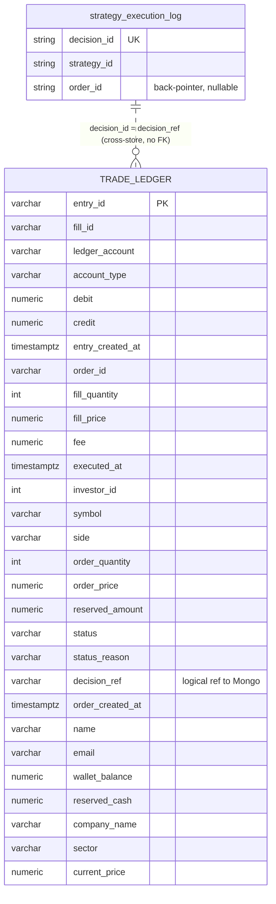
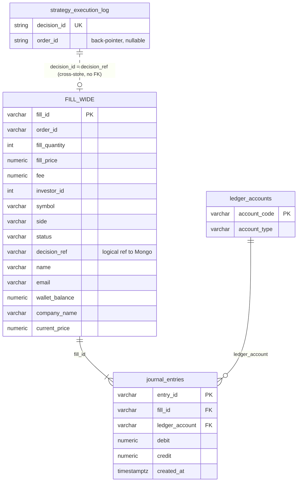
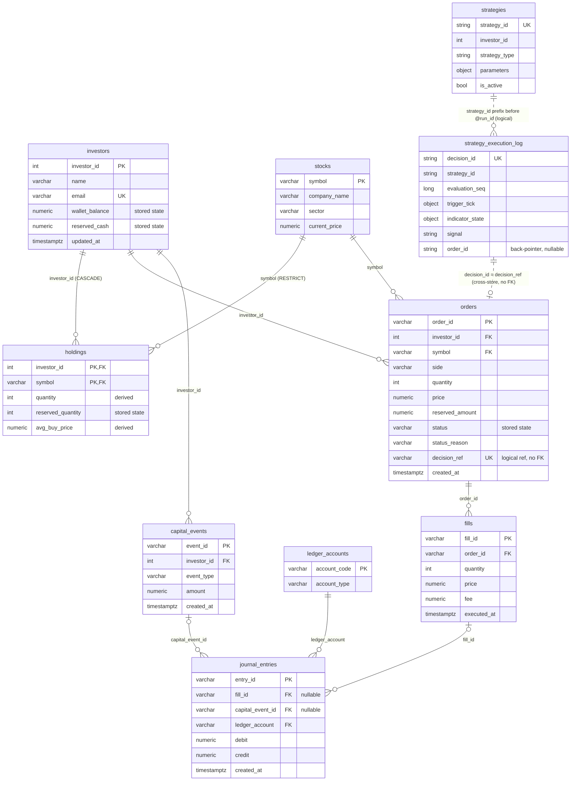

# GlassLedger: Database Normalization

This document explains how the GlassLedger relational schema is normalized and where it deliberately is not. Every table, column and constraint named here is checked against:

- `migrations/postgres/001_initial_schema.sql`, `002_settlement_correctness.sql` and `003_journal_line_uniqueness.sql`
- `src/glassledger/storage/postgres.py` (write paths, and the hand-mirrored SQLite fallback schema)
- `src/glassledger/domain/models.py`
- `migrations/mongo/001_init_collections.js` and `src/glassledger/storage/mongo.py`

Schema claims are asserted by `tests/test_schema_normalization.py`. Invariants on stored (derivable) columns are asserted by `tests/test_denormalization_invariants.py` and `tests/test_settlement.py`. The [Verification status](#9-verification-status) section lists what has and has not actually been run.

---

## 1. Ground truth: the schema after migrations 001–003

All money columns are `NUMERIC(18,4)`; no PostgreSQL column is `REAL`/`FLOAT`. Ledger code uses `Decimal`, and the Pydantic models reject `float` input. Prices and averages are quantized to 4 dp with `ROUND_HALF_UP`. The SQLite fallback does **not** keep this guarantee (§1.9).

Migrations are applied in filename order by `PostgresStorage.run_migrations()`, which records each one in `schema_migrations(version, applied_at)`. `001` is never edited; `002` and `003` are idempotent, and both stop with an error rather than delete rows if existing data violates a new unique key.

### 1.1 investors
| Column | Type | Constraints |
|---|---|---|
| investor_id | SERIAL | **PK** |
| name | VARCHAR(100) | NOT NULL |
| email | VARCHAR(150) | NOT NULL, **UNIQUE** |
| wallet_balance | NUMERIC(18,4) | NOT NULL DEFAULT 0, `ck_wallet_positive` (≥ 0) |
| reserved_cash | NUMERIC(18,4) | NOT NULL DEFAULT 0, `ck_reserved_positive` (≥ 0) |
| updated_at | TIMESTAMPTZ | NOT NULL DEFAULT NOW() |

Table-level: `ck_cash_solvency CHECK (reserved_cash <= wallet_balance)`.

### 1.2 stocks
| Column | Type | Constraints |
|---|---|---|
| symbol | VARCHAR(16) | **PK** |
| company_name | VARCHAR(150) | NOT NULL |
| sector | VARCHAR(64) | NOT NULL |
| current_price | NUMERIC(18,4) | NOT NULL, CHECK (> 0) |

### 1.3 holdings
| Column | Type | Constraints |
|---|---|---|
| investor_id | INT | **PK** part, **FK → investors ON DELETE CASCADE** |
| symbol | VARCHAR(16) | **PK** part, **FK → stocks ON DELETE RESTRICT** |
| quantity | INT | NOT NULL DEFAULT 0, `ck_holding_qty_positive` (≥ 0) |
| reserved_quantity | INT | NOT NULL DEFAULT 0, `ck_holding_reserved_positive` (≥ 0) |
| avg_buy_price | NUMERIC(18,4) | NOT NULL DEFAULT 0 |

Table-level: `ck_holding_solvency CHECK (reserved_quantity <= quantity)`.

### 1.4 orders
| Column | Type | Constraints |
|---|---|---|
| order_id | VARCHAR(64) | **PK** |
| investor_id | INT | NOT NULL, **FK → investors** |
| symbol | VARCHAR(16) | NOT NULL, **FK → stocks** |
| side | VARCHAR(8) | CHECK IN ('BUY','SELL') |
| quantity | INT | CHECK (> 0) |
| price | NUMERIC(18,4) | CHECK (> 0) |
| reserved_amount | NUMERIC(18,4) | NOT NULL DEFAULT 0 |
| status | VARCHAR(16) | CHECK IN ('PENDING','FILLED','REJECTED','CANCELED') |
| decision_ref | VARCHAR(64) | NOT NULL, **UNIQUE** (`uq_orders_decision_ref`, 002), **no FK**: logical link to Mongo `strategy_execution_log.decision_id` |
| created_at | TIMESTAMPTZ | NOT NULL DEFAULT NOW() |
| status_reason | VARCHAR(255) | NULL (002): why an order was CANCELED or REJECTED |

002 drops `idx_orders_decision_ref`; the unique constraint's index replaces it. If an existing database already holds duplicate `decision_ref`s, 002 **stops with an error** rather than deleting rows.

### 1.5 fills
| Column | Type | Constraints |
|---|---|---|
| fill_id | VARCHAR(64) | **PK** |
| order_id | VARCHAR(64) | NOT NULL, **FK → orders** (index `idx_fills_order_id`) |
| quantity | INT | CHECK (> 0) |
| price | NUMERIC(18,4) | CHECK (> 0) |
| fee | NUMERIC(18,4) | NOT NULL DEFAULT 0, CHECK (≥ 0) |
| executed_at | TIMESTAMPTZ | NOT NULL DEFAULT NOW() |

### 1.6 journal_entries
| Column | Type | Constraints |
|---|---|---|
| entry_id | VARCHAR(64) | **PK** |
| fill_id | VARCHAR(64) | **NULL** since 002, **FK → fills** |
| capital_event_id | VARCHAR(64) | NULL (002), **FK → capital_events** |
| ledger_account | VARCHAR(32) | NOT NULL, **FK → ledger_accounts** (`fk_journal_ledger_account`, 002; replaces 001's inline CHECK list) |
| debit / credit | NUMERIC(18,4) | NOT NULL DEFAULT 0, each CHECK (≥ 0) |
| created_at | TIMESTAMPTZ | NOT NULL DEFAULT NOW() |

Table-level:
- `ck_debit_or_credit CHECK ((debit > 0 AND credit = 0) OR (credit > 0 AND debit = 0))`
- `ck_journal_single_source CHECK ((fill_id IS NULL) <> (capital_event_id IS NULL))` (002): every line comes from exactly one fill or one capital event.
- `uq_journal_fill_account UNIQUE (fill_id, ledger_account)` and `uq_journal_capital_account UNIQUE (capital_event_id, ledger_account)` (003): at most one line per account per source. Their indexes replace `idx_journal_fill_id` and `idx_journal_capital_event_id`, which 003 drops.

### 1.7 ledger_accounts (002)
| Column | Type | Constraints |
|---|---|---|
| account_code | VARCHAR(32) | **PK** |
| account_type | VARCHAR(16) | NOT NULL, `ck_account_type` IN ('ASSET','LIABILITY','EQUITY','INCOME','EXPENSE') |

Seeded rows:

| account_code | account_type |
|---|---|
| CASH, SECURITIES_AT_COST | ASSET |
| OWNER_EQUITY | EQUITY |
| REALIZED_GAIN_LOSS | INCOME |
| FEE_EXPENSE, BROKERAGE_EXPENSE, STT_EXPENSE, EXCHANGE_FEE_EXPENSE, GST_EXPENSE, STAMP_DUTY_EXPENSE | EXPENSE |

### 1.8 capital_events (002)
| Column | Type | Constraints |
|---|---|---|
| event_id | VARCHAR(64) | **PK** |
| investor_id | INT | NOT NULL, **FK → investors** (`idx_capital_events_investor`) |
| event_type | VARCHAR(24) | `ck_capital_event_type` IN ('OPENING_BALANCE','CAPITAL_ADJUSTMENT') |
| amount | NUMERIC(18,4) | `ck_capital_amount_nonzero` (≠ 0); `ck_opening_positive` (OPENING_BALANCE ⇒ > 0) |
| created_at | TIMESTAMPTZ | NOT NULL DEFAULT NOW() |

Partial unique index `uq_capital_opening_per_investor (investor_id) WHERE event_type = 'OPENING_BALANCE'` allows at most one opening balance per investor.

**Backfill.** On a database created before 002, the migration posts one `cap_backfill_<investor_id>` event per investor for the gap between `wallet_balance` and that investor's CASH journal. This makes the cash invariant in §6 hold from 002 onward. It does **not** correct pre-002 SELL journals, which credited `SECURITIES_AT_COST` at sale proceeds.

### 1.9 SQLite fallback (non-authoritative)

When PostgreSQL is unreachable on 127.0.0.1:5432, `PostgresStorage` uses `data/glassledger_ledger.db` and logs a loud `NON-AUTHORITATIVE` warning once per process. The fallback mirrors the same tables, foreign keys, unique keys and chart of accounts; `tests/test_schema_normalization.py` checks this parity. It lacks:
- constraint names;
- `SELECT … FOR UPDATE` row locks;
- exact money storage: SQLite NUMERIC affinity stores values as binary `REAL`.

A fallback file from an older schema version is **renamed** to `*.legacy-v<N>-<timestamp>.db` (never deleted), and a fresh file is created. Concurrency and money-precision tests run only on PostgreSQL.

### 1.10 MongoDB collections (`migrations/mongo/001_init_collections.js`)
| Collection | Shape | Indexes |
|---|---|---|
| price_history | time-series, `timeField: ts`, `metaField: symbol` | `{symbol:1, ts:-1}` (+ `{dataset_name:1, ts:1}` created only by `mongo.py`) |
| strategies | required: strategy_id, investor_id, strategy_type ∈ {MA_CROSSOVER, RSI_THRESHOLD}, parameters, version, is_active | unique `strategy_id`; `{is_active, strategy_type}` |
| strategy_execution_log | required: decision_id, strategy_id, evaluation_seq, trigger_tick, indicator_state, signal ∈ {BUY, SELL, HOLD}; optional order_id | unique `decision_id`; unique `{strategy_id, evaluation_seq}` |

### 1.11 Corrections relative to earlier write-ups

| Earlier claim | Reality |
|---|---|
| `orders.execution_log_id` | `orders.decision_ref` |
| `holdings.avg_cost` | `holdings.avg_buy_price` |
| 1NF key was composite | `{entry_id}` alone is a candidate key (§3.2) |
| "SUM of CASH journal lines == wallet_balance" | Was false before 002 because opening capital wasn't journaled. Now exact (§6). |
| ACCOUNTS table / `account → account_type` | Did not exist before 002. Now real as `ledger_accounts` (§4.4). |

---

## 2. Scope of the derivation

The schema was not literally produced by running 0NF → 3NF. The derivation below is an **illustrative reconstruction**: it starts from a "trade ticket" view and shows that decomposing by functional dependencies arrives at the final transactional tables.

Two relations are not outputs of the trade-ticket decomposition, and §4.5 treats them separately:
- `holdings` is a stored aggregate (see §6);
- `capital_events` is a second source of journal lines, besides fills.

---

## 3. 0NF → 1NF

### 3.1 0NF: the trade ticket

```
TRADE_TICKET(order_id, investor_id, name, email, wallet_balance, reserved_cash,
             symbol, company_name, sector, current_price,
             side, order_quantity, order_price, reserved_amount, status, status_reason,
             decision_ref, order_created_at,
             FILLS{ fill_id, fill_quantity, fill_price, fee, executed_at,
                    LINES{ entry_id, ledger_account, account_type, debit, credit, entry_created_at } })
```

Attributes are prefixed where two tables share a column name: `order_quantity` = `orders.quantity`, `fill_price` = `fills.price`, `entry_created_at` = `journal_entries.created_at`, and so on.

### 3.2 1NF: TRADE_LEDGER (one row per journal line)

```
TRADE_LEDGER(entry_id, fill_id, ledger_account, account_type, debit, credit, entry_created_at,
             order_id, fill_quantity, fill_price, fee, executed_at,
             investor_id, symbol, side, order_quantity, order_price, reserved_amount,
             status, status_reason, decision_ref, order_created_at,
             name, email, wallet_balance, reserved_cash,
             company_name, sector, current_price)
```

**Functional dependencies.** All of F1–F9 are declared in the DDL as a PK or UNIQUE.

| # | FD | Source |
|---|---|---|
| F1 | entry_id → fill_id, ledger_account, debit, credit, entry_created_at | PK journal_entries |
| F2 | fill_id → order_id, fill_quantity, fill_price, fee, executed_at | PK fills |
| F3 | order_id → investor_id, symbol, side, order_quantity, order_price, reserved_amount, status, status_reason, decision_ref, order_created_at | PK orders |
| F4 | investor_id → name, email, wallet_balance, reserved_cash | PK investors |
| F5 | email → investor_id | UNIQUE(email) |
| F6 | symbol → company_name, sector, current_price | PK stocks |
| F7 | fill_id, ledger_account → entry_id | UNIQUE(fill_id, ledger_account) (003); before 003 this held only by code convention |
| F8 | ledger_account → account_type | PK ledger_accounts (002) |
| F9 | decision_ref → order_id | UNIQUE(decision_ref) (002) |

`company_name ↛ symbol`: `submit_order_intent` auto-creates unknown symbols with `company_name = symbol`, and nothing makes company_name unique.

**Candidate keys.**
- With declared FDs: **{entry_id}**. Its closure is entry_id → fill_id → order_id → {investor_id, symbol}, plus ledger_account → account_type, which reaches every attribute.
  - F9 makes {decision_ref} a key of the *orders* attributes, but not of TRADE_LEDGER, because one order has many journal lines.
- With F7: **{fill_id, ledger_account}** is a second candidate key (declared since 003).

**Which key matters for 2NF.**
- With only {entry_id}, no partial dependency is possible, so 1NF ⇒ 2NF trivially. Every anomaly here is transitive.
- With F7, `order_id` depends on `fill_id`, a proper subset of {fill_id, ledger_account}. That is a partial dependency, so the relation **violates 2NF**. The 2NF step is taken relative to this natural key of a journal line.

---

## 4. 1NF → 2NF → 3NF → BCNF

### 4.1 2NF: remove the partial dependencies on {fill_id, ledger_account}

Relative to the key {fill_id, ledger_account}, TRADE_LEDGER has two partial dependencies:
- F2 and everything reachable from it depend on **fill_id** alone;
- F8 (`account_type`) depends on **ledger_account** alone.

Remove both:

```
journal_entries(entry_id, fill_id, ledger_account, debit, credit, created_at)
ledger_accounts(account_code, account_type)          -- account_code = ledger_account
FILL_WIDE(fill_id, order_id, fill_quantity, fill_price, fee, executed_at, …all order, investor and stock attributes…)
```

| Relation | Candidate keys | 2NF? |
|---|---|---|
| journal_entries | {entry_id}, {fill_id, ledger_account} | Yes: debit, credit and created_at depend on each whole key |
| ledger_accounts | {account_code} | Yes |
| FILL_WIDE | {fill_id} | Yes (single-attribute key), but transitive FDs remain |

**Lossless join:** each split is on an attribute that is the key of one side. journal_entries ⋈ ledger_accounts is joined on ledger_account = account_code; the result ⋈ FILL_WIDE is joined on fill_id (Heath's theorem).

Under the declared FDs only (key {entry_id}), `entry_id → ledger_account → account_type` is instead a *transitive* dependency. It is removed in 3NF, and the resulting tables are the same.

### 4.2 3NF: remove transitive dependencies from FILL_WIDE

FILL_WIDE has fill_id → order_id → {investor_id, symbol} → …:

1. Split on **order_id** into `fills(fill_id, order_id, quantity, price, fee, executed_at)` and ORDER_WIDE.
   Lossless because {order_id} is the key of ORDER_WIDE.
2. Split ORDER_WIDE on **investor_id** into `investors(investor_id, name, email, wallet_balance, reserved_cash, updated_at)`.
   Lossless because {investor_id} is the key of investors.
3. Split on **symbol** into `stocks(symbol, company_name, sector, current_price)`.
   Lossless because {symbol} is the key of stocks.

What remains is `orders(order_id, investor_id, symbol, side, quantity, price, reserved_amount, status, decision_ref, created_at, status_reason)`.

### 4.3 BCNF check on every final table

| Table | Non-trivial FDs | Determinants | All superkeys? |
|---|---|---|---|
| investors | investor_id → all; email → all | investor_id, email | **Yes** |
| stocks | symbol → all | symbol | **Yes** |
| orders | order_id → all; decision_ref → all (F9) | order_id, decision_ref (both candidate keys) | **Yes** |
| fills | fill_id → all | fill_id | **Yes** |
| journal_entries | entry_id → all; (fill_id, ledger_account) → entry_id (F7); (capital_event_id, ledger_account) → entry_id | entry_id, {fill_id, ledger_account}, {capital_event_id, ledger_account} | **Yes** |
| ledger_accounts | account_code → account_type | account_code | **Yes** |
| capital_events | event_id → all | event_id | **Yes** |
| holdings | (investor_id, symbol) → all | (investor_id, symbol) | **Yes** |

BCNF governs intra-table FDs only. Cross-table redundancy, such as balances equal to sums of other rows, is handled in §6.

### 4.4 ledger_accounts: the account_type step is now real

Before 002, `ledger_account` had no dependent attributes, so there was nothing to decompose. Migration 002 adds `account_type`, which is needed to classify CASH/SECURITIES as assets, OWNER_EQUITY as equity, REALIZED_GAIN_LOSS as income and the fees as expenses. That makes `account_code → account_type` a real FD.

Keeping `account_type` on `journal_entries` would make it transitively dependent on `entry_id` through `ledger_account`, which is a 3NF violation. It therefore lives in `ledger_accounts`, and `journal_entries.ledger_account` is an FK to it. New accounts are rows, not DDL changes to a CHECK list.

### 4.5 capital_events and holdings

**capital_events** (event_id → investor_id, event_type, amount, created_at) is a second source of journal lines. A journal line's investor is reached through its parent:
- `fill_id → order_id → investor_id`, or
- `capital_event_id → investor_id`.

Putting `investor_id` on `journal_entries` would have made it transitively dependent on `fill_id` for trade lines (a 3NF violation). Instead, `ck_journal_single_source` guarantees exactly one parent. The cost is a two-branch join when computing an investor's cash ledger.

**holdings** is not derived by decomposition; it is the stored aggregate described in §6.

### 4.6 strategy_id: one source of truth across stores

```
orders.decision_ref ──(logical, UNIQUE, no FK)──▶ strategy_execution_log.decision_id ──▶ strategy_execution_log.strategy_id
```

`strategy_id` is never copied into PostgreSQL, so `decision_id → strategy_id` is not a relational FD. MongoDB owns decision facts and PostgreSQL owns money facts; one key joins them.

Caveats:
- The Runner stores `strategy_id = "<strategy_id>@<run_id>"`, which is not equal to `strategies.strategy_id`.
- Decision snapshots record `indicator_state`, not the strategy `parameters`.

### 4.7 Dependency preservation

| FD | Table | Enforced by |
|---|---|---|
| F1 | journal_entries | PK |
| F2 | fills | PK |
| F3 | orders | PK |
| F4, F5 | investors | PK, UNIQUE |
| F6 | stocks | PK |
| F7 | journal_entries | UNIQUE (003) |
| F8 | ledger_accounts | PK |
| F9 | orders | UNIQUE |

Every FD lies inside one final table, so the decomposition is dependency-preserving.

The §6 invariants and the cross-store link are **not** FDs, so decomposition cannot preserve them. They are enforced by single-transaction application code, CHECK constraints and tests, plus `CrossStoreReconciler` for the cross-store link.

---

## 5. ER diagrams

Solid lines are enforced FKs. **Dashed** lines are logical references with no FK; the one into PostgreSQL crosses stores.

### 5.1 1NF



### 5.2 2NF



(FILL_WIDE abbreviated; it carries every order, investor and stock attribute from §3.2.)

### 5.3 Final schema (3NF / BCNF)



`ck_journal_single_source` means every journal line has exactly one of the two optional parents (fill or capital event). Mermaid cannot express that rule.

---

## 6. Deliberate controlled denormalization

These stored columns are derivable from the immutable facts (`orders`, `fills`, `journal_entries`, `capital_events`). They are stored for three reasons:

1. **Row locks.** `SELECT … FOR UPDATE` on one `investors` or `holdings` row serializes concurrent orders for that investor or position.
2. **CHECK constraints.** `ck_cash_solvency` and `ck_holding_solvency` can only be declared on stored columns. They make the database the last line of defence.
3. **O(1) solvency checks** at order intake.

Every write that changes them happens inside one transaction:
- `create_investor`
- `reset_investor_cash`
- `submit_order_intent`
- `process_fill`
- `cancel_order` / `reject_order`
- `execute_order`

| Column | Invariant (exact unless noted) | Tests |
|---|---|---|
| investors.wallet_balance | = Σ(CASH.debit − CASH.credit) over the investor's journal lines from fills **and** capital events | `test_wallet_balance_equals_cash_journal_exactly`, `test_cash_journal_equals_wallet_balance_exactly_after_trading`, `test_create_investor_journals_opening_capital`, `test_cash_reset_is_journaled_and_preserves_invariant`; exact-decimal PG check `test_pg_money_is_exact_decimal_without_tolerance` |
| investors.reserved_cash | = Σ reserved_amount of the investor's PENDING BUY orders | `test_reserved_cash_equals_pending_buy_reservations`, cancel/reject tests |
| holdings.quantity | = Σ BUY fill qty − Σ SELL fill qty | `test_holding_quantity_equals_signed_fill_sum` |
| holdings.reserved_quantity | = Σ quantity of PENDING SELL orders for (investor, symbol) | `test_reserved_quantity_equals_pending_sell_quantity`, `test_sell_reserves_shares_at_intake_and_releases_on_fill`, PG concurrency test |
| holdings.avg_buy_price | Moving weighted average of BUY fills, fees excluded, rounded HALF_UP to 4 dp, unchanged by SELLs | `test_avg_buy_price_is_fee_exclusive_weighted_average_of_buys`, `test_avg_buy_price_and_cost_basis_round_half_up_to_4dp` |
| orders.status | FILLED ⇔ a fill exists; CANCELED/REJECTED ⇒ reservation released | `test_order_status_filled_iff_fill_exists`, lifecycle tests |
| fills.fee | = Σ debit of the fill's `*_EXPENSE` lines | `test_fill_fee_equals_sum_of_expense_journal_lines` |

Also enforced:
- per-fill journal balance (`assert_balanced_journal`, `test_every_fill_journal_is_balanced`);
- realized P&L = Σ(credit − debit) of the investor's `REALIZED_GAIN_LOSS` lines (`get_pnl_summary`, `test_realized_pnl_equals_sum_of_realized_gain_loss_lines`).

### SELL accounting (002 onward)

A SELL of q shares at price p with fee f, against an average cost a, posts:

| Account | Debit | Credit |
|---|---|---|
| CASH | q·p − f | |
| `*_EXPENSE` lines | f (in total) | |
| SECURITIES_AT_COST | | round(q·a) |
| REALIZED_GAIN_LOSS | (loss) | q·p − round(q·a) (gain) |

Realized P&L is **gross of fees**; fees remain visible as expense lines.

### Caveats
- **SECURITIES_AT_COST** per position equals Σ buy notional − Σ relieved cost basis exactly. It equals `quantity × avg_buy_price` only up to the 4-dp rounding of the average, so no exact invariant is claimed for that form.
- **Pre-002 data:** SELL journals credited SECURITIES_AT_COST at proceeds with no gain line. The backfill fixes the CASH invariant but not those historical lines.
- **Logic vs precision:** the invariant tests run on whichever backend is active and compare at 4 dp. On the SQLite fallback they verify logic only; exact-decimal equality is asserted only on PostgreSQL.

---

## 7. MongoDB side

### 7.1 Why it is denormalized
- `strategy_execution_log` documents are immutable decision snapshots. `trigger_tick` deliberately copies the tick, so the decision stays self-describing for audit and replay.
- `indicator_state` is polymorphic per strategy type.
- Access is "fetch the whole decision by id".
- Prices are stored as `Decimal128`.

### 7.2 The cross-store reference
- `orders.decision_ref` holds a `decision_id`, and is now UNIQUE, so it is one order per decision.
- The decision stores `order_id` as a back-pointer.

No FK is possible in either direction. Integrity rests on write order plus audit.

### 7.3 Write order (`Runner.run_strategy`, web `/api/trade/execute`)
1. **Mongo first:** `log_decision`, an upsert on `decision_id`.
2. **PostgreSQL second:** `PostgresStorage.execute_order`, which runs in one transaction:
   - `submit_order_intent`: lock investor, then for a SELL also the holding; validate; reserve cash or shares; insert the order;
   - `broker.submit_order`;
   - `process_fill`: idempotency check; lock investor → holding → order; require PENDING; settle; insert fill and journal; set FILLED.

| Failure | Resulting state | Reconciler class | Test |
|---|---|---|---|
| Crash after Mongo write, before PG commit | Decision with `order_id`, no PG order, no money moved | `ORPHAN_DECISION_HARMLESS` | `test_reconciler_detects_injected_failure_between_writes` |
| Insufficient funds or holdings at intake | Transaction rolled back, then the order is recorded as **REJECTED** with `status_reason`; nothing reserved; the run continues | consistent | `test_execute_order_records_validation_failure_as_rejected` |
| Broker raises `BrokerRejectedError` | Reservation released and order REJECTED in the same transaction | consistent | `test_execute_order_broker_rejection_releases_reservation_atomically` |
| Same order replayed (same run_id) | `execute_order` returns the existing status; no second reservation | consistent | `test_execute_order_is_idempotent_on_replay`, `test_resubmitting_an_order_id_has_no_second_effect` |
| Same fill replayed | `ALREADY_APPLIED` | n/a | `test_idempotency.py` |
| Crash mid-cancel before commit | Order stays PENDING, reservation intact | n/a | `test_crash_mid_cancel_rolls_back_atomically`; PG SIGKILL: `test_real_subprocess_sigkill_mid_cancel_keeps_reservation` |
| PG order written without a decision (bypassing Runner) | Money-side record without provenance | `ORPHAN_ORDER_CRITICAL` | `test_reconciler_detects_orphan_order_in_postgres` |
| Mongo write fails | Exception before any PG write | n/a | not tested |

### 7.4 CrossStoreReconciler
`src/glassledger/diagnostics/reconciler.py` runs on demand via `glassledger reconcile` or `/api/reconcile`. Limitations:
- The `run_id` filter relies on ID prefixes.
- It checks that referenced ids **exist** on the other side, not that the two pointers point at **each other**.

---

## 8. Viva notes (short answers with caveats)

**Is the schema in 3NF? BCNF?**
Yes to both, for the FDs in §3.2. Every determinant in every table is a key (§4.3).
*Caveat:* stored balances are deliberate cross-table redundancy (§6), guarded by transactions, CHECKs and tests.

**Key of the 1NF relation?**
{entry_id}, and {fill_id, ledger_account}, which migration 003 declares UNIQUE.
*Caveat:* the 2NF step is only meaningful relative to the composite key; with {entry_id} alone, 1NF is already 2NF.

**Why store wallet_balance if it is derivable?**
Row locks, `ck_cash_solvency`, and O(1) solvency checks.
*Caveat:* it must equal the CASH journal exactly. Since 002 that includes opening capital, and it is tested.

**Why is realized P&L gross of fees?**
Fees are posted to their own expense accounts; netting them into REALIZED_GAIN_LOSS would double-count them.
*Caveat:* "net P&L" = realized − Σ fee expenses.

**Why is ledger_accounts a separate table now?**
`account_type` creates a real FD, `account_code → account_type`, which would otherwise be transitive in journal_entries.
*Caveat:* the CHECK on `account_type` still fixes the five types in DDL.

**Why no FK from orders to the decision log?**
The decision log is in another database. Integrity comes from Mongo-first write order plus the reconciler.
*Caveat:* the reconciler checks existence, not mutual pointing, and runs on demand.

**Does the SQLite fallback give the same guarantees?**
No. It has the same tables, FKs and unique keys, but money is stored as `REAL` and there are no row locks. It warns loudly and is for demos only.

---

## 9. Verification status

Two runs on the development machine (Windows 11, MongoDB running in both):

- **PostgreSQL run:** a throwaway local **PostgreSQL 16.2** cluster (from the `pgserver` wheel) on 127.0.0.1:5432. `pytest -rs` gave **106 passed, 0 skipped**, repeated twice in a row.
- **Fallback run** (PostgreSQL stopped): **90 passed, 16 skipped**. The skips are exactly the PostgreSQL-only tests.

| Check | Where | PostgreSQL 16.2 | SQLite fallback |
|---|---|---|---|
| Migrations declare the documented tables, named CHECKs, indexes, chart of accounts, unique keys; no float types | static, `test_schema_normalization.py` | Passed | Passed |
| SQLite fallback mirrors tables, FKs, single and composite unique keys, chart of accounts | `test_schema_normalization.py` | Passed | Passed |
| Live catalog: PKs, FKs, UNIQUEs (incl. 003 composites), named CHECKs, ledger_accounts content, nullable fill_id, indexes, no float columns, migrations recorded | `test_schema_normalization.py` (9 tests) | **Passed** | skipped |
| Settlement logic: SELL validation, share reservation, SELL accounting, opening capital, lifecycle, UNIQUE(decision_ref), one line per account per source | `test_settlement.py` | **Passed** | Passed (logic only) |
| Denormalization invariants (§6) | `test_denormalization_invariants.py` | **Passed** | Passed (logic only) |
| Concurrent BUY (10 threads, 2 accepted) and SELL (10 threads, 3 accepted) under `FOR UPDATE` | `test_invariants.py` | **Passed** | skipped |
| `ck_holding_solvency` fires by name | `test_invariants.py` | **Passed** | skipped |
| Exact-decimal money (0.1 / 0.2 amounts, plain `==`) | `test_backend_authority.py` | **Passed** | skipped |
| SIGKILL mid-transaction rollback; SIGKILL mid-cancel keeps reservation | `test_crash_recovery.py` | **Passed** | skipped |
| Migration 002 on a legacy-shaped DB: duplicate guard stops 002 without deleting rows; per-file transactions; backfill makes CASH == wallet; journal balanced; re-run is a no-op | `test_migrations_pg.py` | **Passed** | skipped |

Caveats about the PostgreSQL run:
- **Version.** It was 16.2, not 16.8. Docker's `postgres:16-alpine` was not available on this machine.
- **uuid-ossp stub.** The `pgserver` build ships without contrib extensions, so `001`'s `CREATE EXTENSION "uuid-ossp"` was satisfied by an **empty stub** installed into the throwaway cluster only. No GlassLedger code calls any uuid-ossp function (all ids are application-generated VARCHARs), so behaviour is unaffected. Standard PostgreSQL installs ship the real extension.
- **Authentication.** The project's local `.env` has a password-less `POSTGRES_URI`, so the run supplied the password via libpq's `PGPASSWORD`.

Bugs found only by the first real PostgreSQL run, and fixed:
- `PortfolioManager` indexed a psycopg dict row by position (`row[0]`), raising `KeyError` on PostgreSQL. It now reads by column name.
- `run_migrations` ran all files inside one implicit transaction, so a failure in 002 also rolled back 001. Each file now commits independently, as documented.
- The SIGKILL mid-cancel test's child script had a string-escaping error.
